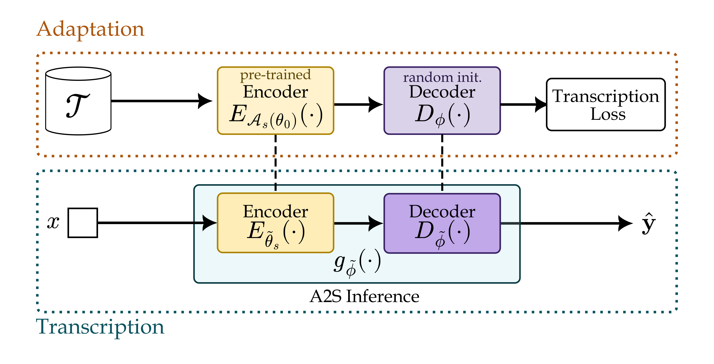

<p align='center'>
  <a href='https://praig.ua.es/'></a>
</p>

<h1 align='center'>On the use of Pre-Trained Audio Encoders for Audio-to-Score Music Transcription</h1>

<h4 align='center'>Full text available <a href='https://ismir2026program.ismir.net/poster_164.html#paper' target='_blank'>here</a>.</h4>

<p align='center'>
  
  
  
</p>

<p align='center'>
  <a href='#about'>About</a> •
  <a href='#how-to-use'>How To Use</a> •
  <a href='#citations'>Citations</a> •
  <a href='#acknowledgments'>Acknowledgments</a>
</p>

## About

This repository contains the official implementation for the experiments presented in the accompanying paper: **On the use of Pre-trained Audio Encoders for Audio-to-Score Music Transcription**, accepted at The 27th International Society for Music Information Retrieval Conference (ISMIR).


<p align="center">
  
<br>
</p>

## How To Use

### Local Requirements

If running locally, first install the required PyTorch dependencies. If you want to use a GPU (recommended), follow the official [PyTorch installation instructions](https://pytorch.org/get-started/locally/) and select the appropriate CUDA version for your system.

Then install the system dependencies and MUSTER:

```bash
sudo apt update
sudo apt install -y build-essential wget ffmpeg libsm6 unzip
```

Download and compile MUSTER:

```bash
wget https://github.com/TimFelixBeyer/amtevaluation.github.io/raw/refs/heads/main/MUSTER_v231108.zip -O muster.zip
unzip muster.zip -d MUSTER_tmp
mv "MUSTER_tmp/MUSTER 2" MUSTER
rm -rf muster.zip MUSTER_tmp

cd MUSTER
./compile.sh
cd ..
```

Finally, install the Python dependencies:

```bash
pip install --upgrade pip
pip install pybind11
pip install -r requirements.txt
```


### Docker

Alternatively, a [Dockerfile](Dockerfile) is provided with all required system and Python dependencies, including MUSTER. To build the Docker image:

```bash
docker build -t a2s-pretrained-image .
```

Then run the container with:

```bash
docker run -v /home/your/project/dir/:/workspace --gpus '"device=1"' --shm-size=20g --name a2s-pretrained-container -it -d a2s-pretrained-image
```

The provided Dockerfile uses **PyTorch 2.7.1 with CUDA 12.8 and cuDNN 9** and installs MUSTER automatically.

### Authentication

To log the training and to pull the models and datasets from the hub, authentication for wandb and hugging face is required, respectively, so within you environment, run:

```bash
wandb login
```
```bash
hf auth login
```

### Training and Evaluation

`train.py` runs training for the adaptation phase of the pre-trained encoder, with options to freeze parameters, apply lora or fully fine-tune (default):

```bash
python train.py --encoder_name <'cnn', 'music2vec', 'mert', 'wav2vec2', 'whisper', 'qwen2' or 'flamingo3'>  \
  <--freeze_encoder or --lora_encoder>
```
This will save the models and configurations at `./weights/<dataset>_<encoder name>_<adaptation>`.

The file `run_experiments.sh` adapts all the evaluated encoders for a given adaptation:
```bash
bash run_experiments.sh <lora, frozen or finetuning>
```


### Testing

`test.py` executes the transcription phase on the unseen test partition of the dataset. Given the weights obtained from the adaptation stage, to transcribe the unseen audios:

```bash
python test.py --checkpoint_dir "./weights/<dataset>_<encoder name>_<adaptation>/all.ckpt" --test_composer <'all', 'mozart', 'beethoven' or 'haydn'>
```

## Citations

```bibtex
  TBD
```

## Acknowledgments

This research was supported by the Spanish Ministry of Science and Innovation through the LEMUR research project (PID2023-148259NB-I00), funded by MCIU/AEI/10.13039/501100011033/FEDER, EU, and the European Social Fund Plus (FSE+).

<p align="center">
    <a href="https://praig.ua.es/category/research/projects/"></a>
    &nbsp;
    <a href="https://www.aei.gob.es/"></a>
    <br>
</p>
